#  Obsidian

Search, create and append to notes in all your Obsidian vaults from Alfred. Works with every vault Obsidian knows, reads Obsidian’s own settings for daily notes, templates, links and excluded files, and needs no Obsidian plugin.

## Usage

Search your notes via the `obs` keyword. Titles, aliases, headings and the text of notes are searched together, and accents and case are ignored. With nothing typed, the notes you opened last in Obsidian come first.

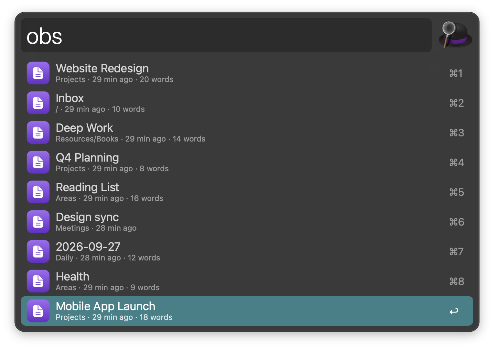

* <kbd>↩</kbd> Open the note in Obsidian.
* <kbd>⌘</kbd><kbd>↩</kbd> Paste a link to the note into the frontmost app.
* <kbd>⌥</kbd><kbd>↩</kbd> Reveal in Finder.
* <kbd>⌃</kbd><kbd>↩</kbd> Open in a new tab.
* <kbd>⇧</kbd><kbd>↩</kbd> Append the clipboard to the note.
* <kbd>fn</kbd><kbd>↩</kbd> Open in your default Markdown editor.
* <kbd>⌘</kbd><kbd>⌥</kbd><kbd>↩</kbd> Copy the Obsidian URI.
* <kbd>⌘</kbd><kbd>⇧</kbd><kbd>↩</kbd> Copy a Markdown link to the Obsidian URI, for use outside Obsidian.
* <kbd>⌘</kbd><kbd>C</kbd> Copy a link to the note.
* <kbd>⌘</kbd><kbd>Y</kbd> Quick Look the note.

A heading that matches gets its own row (when its note’s name doesn’t already match), which opens the note at that heading and links to it (`[[Note#Heading]]`). Links follow the vault’s “Use [[Wikilinks]]” setting.

Narrow the search while you type:

* `#tag` for notes with a tag (nested tags included), like `obs #project budget`. Typing `#` alone lists your tags.
* `/folder` for notes in a folder, like `obs /journal`.
* `@vault` for one vault, like `obs @work plan`.

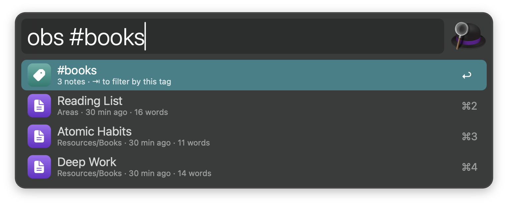

Type `>` after a note’s name, then text, to append it to that note: `obs shopping > oat milk`. Pick a heading row to append under that heading.

* <kbd>↩</kbd> Append as a bullet (or the format set in the Workflow’s Configuration).
* <kbd>⌥</kbd><kbd>↩</kbd> Append as a task.
* <kbd>⌃</kbd><kbd>↩</kbd> Append as a bullet with the time.
* <kbd>fn</kbd><kbd>↩</kbd> Append as a paragraph.
* <kbd>⇧</kbd><kbd>↩</kbd> Append and open the note.

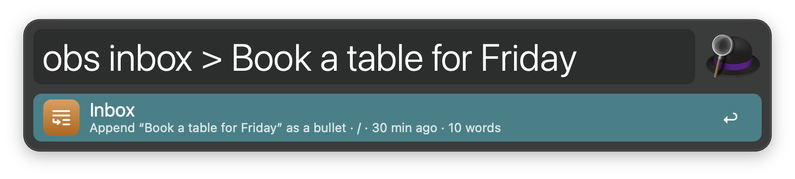

When nothing matches, <kbd>↩</kbd> creates a note with that name.

### Daily Note

Open today’s daily note via the `obd` keyword, or yesterday’s or tomorrow’s. It is created from your daily note template when it doesn’t exist yet, in the folder and date format set in Obsidian’s Daily notes (or Periodic Notes) settings. Type `obd yesterday`, `obd tomorrow` or a date like `obd 2026-01-05` for another day.

On a day’s row, <kbd>⌘</kbd><kbd>↩</kbd> pastes a link to it, <kbd>⌥</kbd><kbd>↩</kbd> reveals it in Finder and <kbd>⌃</kbd><kbd>↩</kbd> opens it in a new tab.

Type text after the keyword to append it to today’s daily note, like `obd call the bank`. The same modifiers as above choose the format. Set a heading in the Workflow’s Configuration, like `## Log`, to add entries under it. Start with `@vault` to use another vault.

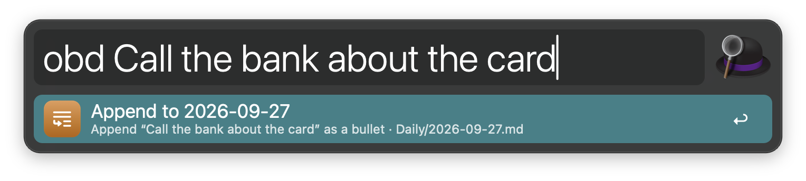

Alternatively, append selected text via the Universal Action, or configure the Hotkey to append the selection without opening Alfred.

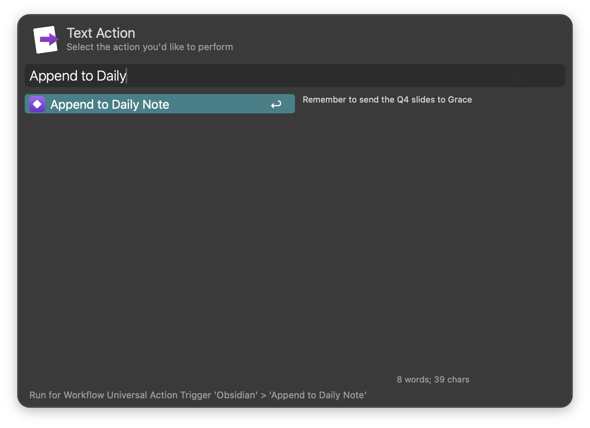

### New Note

Create a note via the `obn` keyword. Type a title, or `Folder/Title` to put it in a folder (created when needed). Add `#tags` to put them in the note’s properties, `> text` for its content, and `@vault` for another vault: `obn Projects/Launch plan #work > First draft`. A row for each template in the vault’s templates folder follows.

* <kbd>↩</kbd> Create and open the note.
* <kbd>⌥</kbd><kbd>↩</kbd> Create it with the clipboard as its content.
* <kbd>⇧</kbd><kbd>↩</kbd> Create it without opening it.
* <kbd>⌃</kbd><kbd>↩</kbd> Create it and open it in a new tab.

Templates can use Obsidian’s `{{title}}`, `{{date}}`, `{{time}}`, `{{date:YYYY-MM-DD}}` and `{{time:HH:mm}}`, plus `{{date+1d:dddd}}` (d, w, M, y), `{{yesterday}}`, `{{tomorrow}}`, `{{clipboard}}` and `{{content}}` (where the text after `>` goes; otherwise it is added at the end).

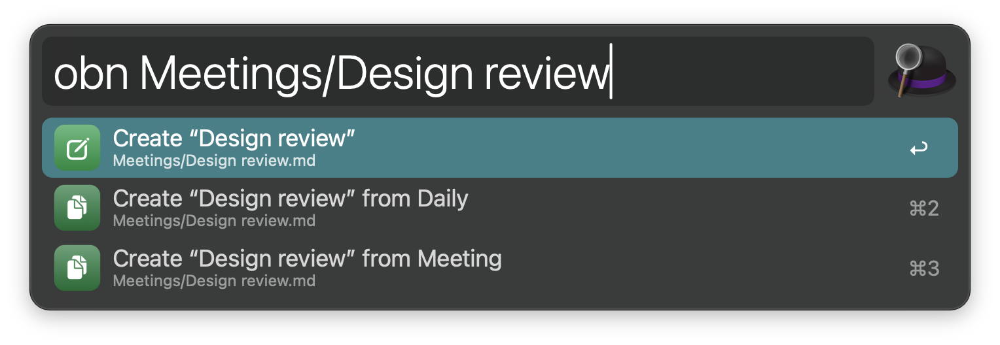

Alternatively, turn selected text into a new note via the Universal Action. Its first line becomes the title.

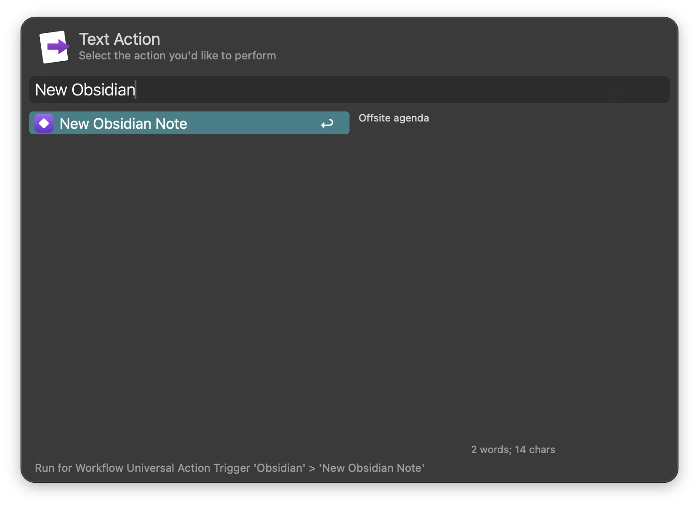

### Attachments

Find images, PDFs, audio, video and other files in your vaults via the `obm` keyword. Filter with `image`, `pdf`, `audio`, `video` or an extension like `.png`.

* <kbd>↩</kbd> Open in Obsidian.
* <kbd>⌘</kbd><kbd>↩</kbd> Paste an embed like `![[photo.png]]` into the frontmost app.
* <kbd>⌥</kbd><kbd>↩</kbd> Reveal in Finder.
* <kbd>⌃</kbd><kbd>↩</kbd> Copy the file to the clipboard.
* <kbd>⇧</kbd><kbd>↩</kbd> Open in a new tab.
* <kbd>fn</kbd><kbd>↩</kbd> Open in the default app.

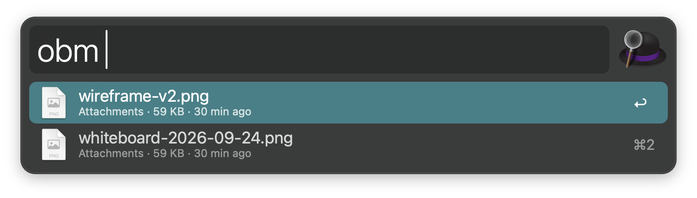

### Bookmarks

See the notes, headings, folders, searches and links you bookmarked in Obsidian via the `obb` keyword. Bookmarked notes have the same actions as in the search.

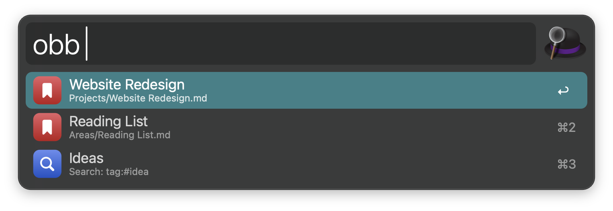

### Vaults

List your vaults via the `obv` keyword, with how many notes each has.

* <kbd>↩</kbd> Open the vault in Obsidian.
* <kbd>⇧</kbd><kbd>↩</kbd> Open a random note from the vault.
* <kbd>⌥</kbd><kbd>↩</kbd> Reveal in Finder.
* <kbd>⌃</kbd><kbd>↩</kbd> Rebuild the vault’s search index.
* <kbd>fn</kbd><kbd>↩</kbd> Open the vault’s daily note.

The first row opens a random note from any vault.

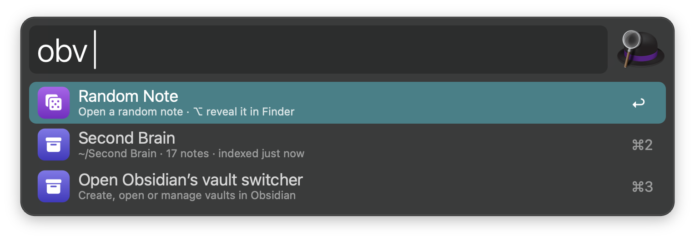

### Search Selected Text

Search your vaults for selected text via the Universal Action, or configure the Hotkey to start a search.

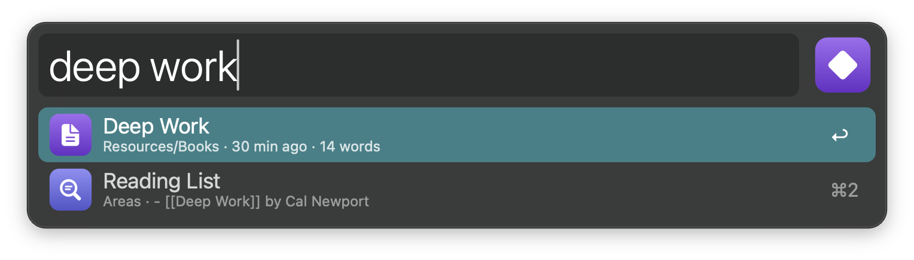

### Configuration

In the Workflow’s Configuration you can limit the workflow to some vaults (or add a vault folder Obsidian doesn’t know), choose the vault for new notes and the daily note, open notes in a new tab, split or window, choose the link format, leave folders out of searches, turn off searching the text of notes, and set the append format, a custom format such as `- {{time}} {{text}}`, the daily note heading, the folder and default template for new notes.

The search index is kept in the workflow’s cache and refreshed in the background while you search, so new and changed notes appear within seconds. Only changed notes are read again. The index of a vault you remove from Obsidian, or leave out in the Workflow’s Configuration, is deleted.

Every keyword can be changed in the Workflow’s Configuration.

## Development

```bash
swift tools/make_icons.swift tools/icons.json src   # regenerate icons
python3 tools/build.py --package                     # write src/info.plist and dist/*.alfredworkflow
python3 -m unittest discover -s tests                # run the tests
```

## AI disclosure

This workflow was developed with the help of Claude (Anthropic), an AI assistant. The code is reviewed and tested by the author.
